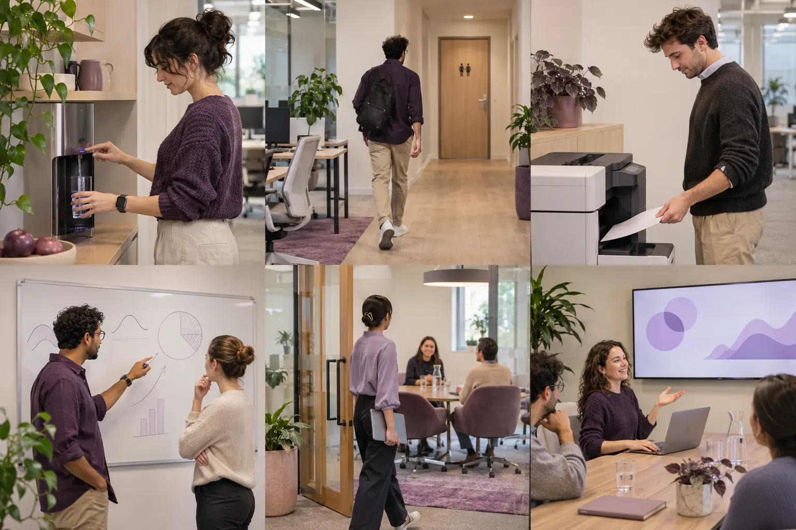
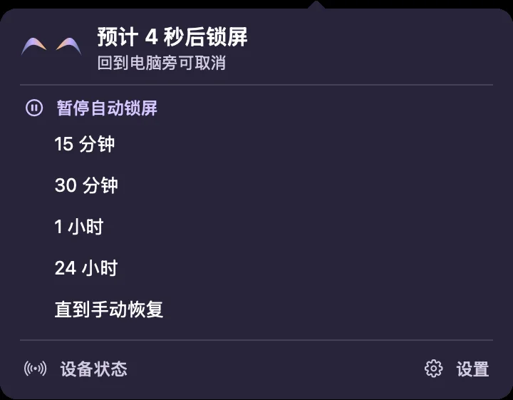
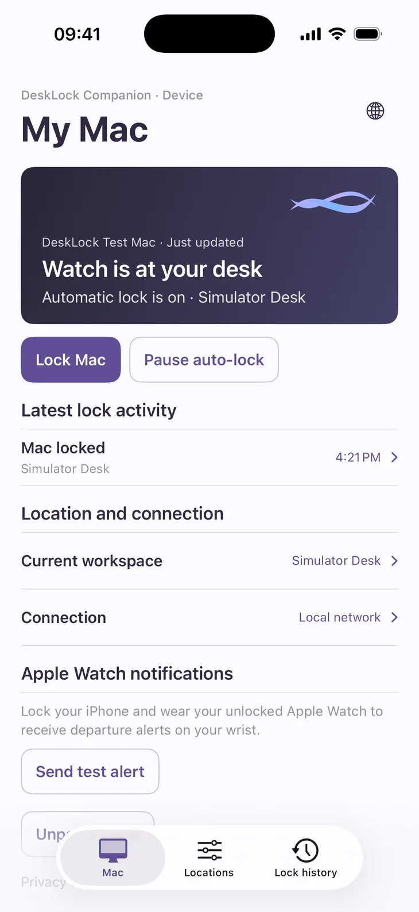
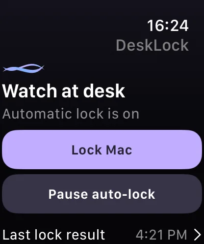

# DeskLock · 离开电脑时，让 Mac 自动锁屏

[简体中文](https://chengfei001.github.io/desklock-support/support.html#zh-Hans) · [繁體中文](https://chengfei001.github.io/desklock-support/support.html#zh-Hant) · [English](https://chengfei001.github.io/desklock-support/support.html#en) · [日本語](https://chengfei001.github.io/desklock-support/support.html#ja) · [Deutsch](https://chengfei001.github.io/desklock-support/support.html#de) · [한국어](https://chengfei001.github.io/desklock-support/support.html#ko) · [Español (España)](https://chengfei001.github.io/desklock-support/support.html#es-ES) · [Español (México)](https://chengfei001.github.io/desklock-support/support.html#es-MX)

接杯水、去洗手间、取打印件，或临时去会议室。戴着 Apple Watch 或带上 iPhone，离开座位时 Mac 会自动锁屏。

| 什么时候 | DeskLock 怎么帮 |
|---|---|
| 去接水、去洗手间，手机还在桌上 | 戴 Apple Watch 走开，检测到离开后请求 Mac 自动锁屏。 |
| 去打印机、被同事叫去白板旁 | 在 iPhone 查看最近的锁屏记录，确认 Mac 是否锁上。 |
| 走开后发现屏幕还亮着 | 在配对和连接可用、自动锁屏已经启用时，从 iPhone 或 Apple Watch 点「锁定 Mac」。 |
| 在这台 Mac 上开会、投屏 | 从菜单栏定时暂停，结束后自动恢复，或提前手动恢复。 |

  
  

## Step away from your Mac

A restroom break, a water refill, or a quick meeting can leave your work visible. Wear your Apple Watch or take your iPhone with you, and your Mac locks automatically when you step away. If you find the Mac still unlocked, you can also tap **Lock Mac** from a paired iPhone or Apple Watch while the connection is available. The watch relays through the paired iPhone.

[免费下载 Mac 版 · Free Mac download](./DeskLock-1.0.0-35-macOS-notarized.zip) · [完整产品说明与截图 · Product guide and screenshots](https://chengfei001.github.io/desklock-support/support.html) · [隐私政策 · Privacy policy](https://chengfei001.github.io/desklock-support/privacy.html)

macOS 14 或更新版本。iPhone 和 Apple Watch 伴侣正在准备上架。界面截图使用示例数据。
